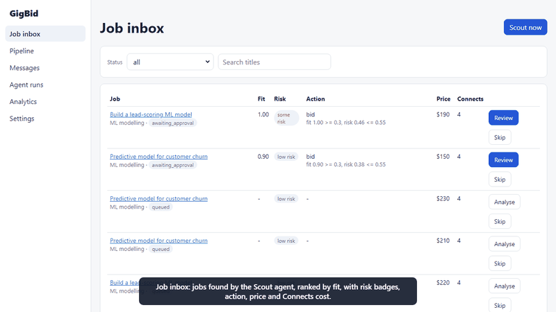
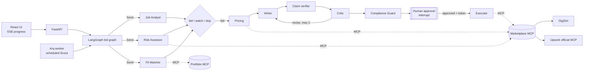

# GigBid: a multi-agent freelancer copilot

> GigBid finds freelance jobs, flags scams and prompt injections, decides whether a job is worth your Connects, and
> drafts proposals in which **every claim links to your own portfolio**. **Nothing is sent until you approve it.**

 <!-- 30-second screen recording: record with the dev stack, save as docs/images/demo.gif -->

**Live app:** `<your public URL>` (reviewer login in the private submission comment) · **Traces:** Phoenix links to a
skipped scam, an approved proposal, a Critic loop and a crash-and-resume (`<trace links>`) · **Portfolio MCP server:**
[mcp_servers/portfolio/README.md](mcp_servers/portfolio/README.md)

## How it works

Second graph: client conversations (intent, interview slots, negotiation within your floor, scam replies), behind the
same approval gate. Details: [docs/ARCHITECTURE.md](docs/ARCHITECTURE.md) · graphs rendered from code:
[bid](docs/images/bid_graph.mmd), [conversation](docs/images/conversation_graph.mmd).

## Results (every number below is generated from `evals/results/` by `python -m scripts.make_tables`)
<!-- results:start -->
**Retrieval variants** (600 dev jobs, 3 personas; reranking variants on a 40-per-persona subset):
<!-- table:rag -->
| Variant | Recall@5 | MRR | nDCG@10 | p95 latency (s) | n jobs |
|---|---|---|---|---|---|
| v0_naive | 0.556 | 0.690 | 0.599 | 0.0032 | 484 |
| v1_decompose | 0.403 | 0.593 | 0.473 | 0.0222 | 484 |
| v2_hybrid | 0.546 | 0.694 | 0.620 | 0.0080 | 484 |
| v4_outcome | 0.551 | 0.715 | 0.594 | 0.0051 | 484 |
| v5_multivector | 0.492 | 0.640 | 0.579 | 0.0028 | 484 |
| v6_contextual | 0.583 | 0.722 | 0.615 | 0.0071 | 484 |
| v9_skill_graph | 0.686 | 0.836 | 0.739 | 0.0115 | 484 |
| v10_hybrid_outcome | 0.556 | 0.720 | 0.620 | 0.0119 | 484 |
<!-- /table:rag -->

**Headline:**
<!-- table:headline -->
| Variant | Evidence Recall@5 | nDCG@10 | Unsupported claims / proposal | Judge score | GigSim reply rate | p95 latency (s) | Cost / proposal (USD) |
|---|---|---|---|---|---|---|---|
| V0 (naive dense) | 0.556 | 0.599 | - | see judge_labels.csv | - | - | - |
| Shipped: V9 skill graph | 0.686 | 0.739 | - | see judge_labels.csv | - | - | 0.0025 |
<!-- /table:headline -->

**Decisions:**
<!-- table:decision -->
| Profile | Bid/skip F1 | Accuracy | Scam precision | Scam recall | Price in fair band | p95 latency / job (s) | Tokens / job | n |
|---|---|---|---|---|---|---|---|---|
| heuristic (no LLM) | 0.606 | 0.675 | 1.000 | 1.000 | 0.567 | 25.5 | 0 | 120 |
<!-- /table:decision -->
<!-- table:holdout -->
_pending: hidden-set run_
<!-- /table:holdout -->

**Single agent vs supervisor vs our graph (R&D C):**
<!-- table:svm -->
| Design | Bid/skip accuracy | Unsupported claims / proposal | Compliance violations left | Tokens / job | Latency / job (s) | Errors | n |
|---|---|---|---|---|---|---|---|
| react | 0.500 | - | 0 | 5915 | 32.3 | 0 | 6 |
| supervisor | 0.833 | 1.000 | 0 | 7757 | 93.7 | 0 | 6 |
| graph | 0.667 | 0.000 | 0 | 5350 | 33.6 | 0 | 6 |
<!-- /table:svm -->

**Proposal A/B test (X2):**
<!-- table:outcomes -->
_pending: run `python -m evals.runners.gigsim_outcomes`_
<!-- /table:outcomes -->
<!-- results:end -->

Findings worth reading: cross-encoder reranking *hurt* retrieval on this corpus; the skill graph wins overall but
loses on vague posts; the change request took about 22 changed lines in 4 files. Full write-up:
[docs/report/REPORT.md](docs/report/REPORT.md) (PDF alongside).

## Run it
```
docker compose -f infra/docker-compose.yml --env-file .env up --build     # everything, on http://localhost:8000
```
Without Docker (Windows/macOS/Linux, Python 3.12, Node 22):
```
uv sync --extra dev
cd apps/web && npm ci && npx vite build && cd ../..
python -m scripts.dev_stack            # GigSim + API + web on :8000 (GIGBID_FAKE_LLM=1 for offline)
```
`make test` · `make eval` · `make demo` - see [Makefile](Makefile). Copy `.env.example` to `.env` and add `GROQ_API_KEY`.

## Stack (pinned in `uv.lock` / `package-lock.json`)
Python 3.12 · LangGraph 1.2 · MCP Python SDK 1.30 · langchain-mcp-adapters 0.3 · FastAPI · SQLAlchemy · Postgres 16 ·
Redis 7 + Arq · Qdrant 1.12 · sentence-transformers (BAAI/bge-small-en-v1.5, ms-marco-MiniLM-L-6-v2) · Groq open
models (gpt-oss-20b / gpt-oss-120b, Qwen3.8-27B) · Ollama · Arize Phoenix · React 18 + Vite 5 + TypeScript 5.6 ·
Playwright 1.49.

## Repository map
`agent/` graphs, nodes, prompts, memory, config · `rag/` ingestion, indexes, variants, claim verification ·
`mcp_servers/` portfolio, marketplace (+ adapters), workspace · `gigsim/` marketplace simulator · `apps/api`,
`apps/web` · `worker/` · `evals/` datasets, runners, results · `tests/` unit, integration, contract · `infra/` ·
`docs/` (ARCHITECTURE, TOOLS, DATA_CARD, RUNBOOK, EXTENSION, AI_USAGE, adr/, report/).
